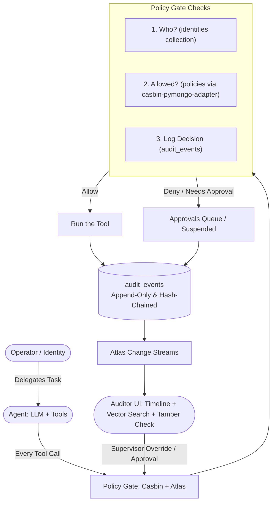

# Transactions Monitor: Auditable Payment Exception Resolution Agent

> Built for **Agents in Context Toronto: A MongoDB Hackathon**  
> Problem Statement: **Problem 1 – Agents You Can Audit**

---

## 📌 Overview

Financial operations teams handle high volumes of payment exceptions (e.g., sanctioned accounts, mismatched routing numbers, suspicious velocity, or over-limit transfers). 

**Transactions Monitor** is an autonomous AI operations agent that investigates and resolves payment exceptions. Rather than granting unconstrained execution permissions, **every single tool call is intercepted by a MongoDB Atlas governance layer** that enforces:

1. **Identity & Delegation:** The agent acts explicitly on behalf of an authenticated human operator with defined roles and delegations (`Agent X` acts for `User Y`).
2. **Pre-Execution Policy Gates:** Deterministic policies evaluated *before* execution (e.g., holds under \$10K permitted, releases over \$50K require secondary human approvers, no access to VIP PII).
3. **Immutable, Tamper-Evident Audit:** An append-only ledger in MongoDB Atlas capturing intent, policy decisions, tool inputs/outputs, reasoning, and cryptographic hash chains.
4. **Real-time Change Streams:** Real-time visibility into agent actions, flags, and approvals via MongoDB Atlas Change Streams.

---

## 🏗️ Architecture



### Policy Engine Selection: Casbin + MongoDB Adapter
To keep MongoDB Atlas at the core as the identity, policy, and audit layer:
- **Engine:** [Casbin](https://casbin.org/) with native [`casbin-pymongo-adapter`](https://github.com/pycasbin/pymongo-adapter).
- **Storage:** Policies reside directly in an Atlas collection (`policies`), allowing instant rule updates without deploying code or maintaining separate policy servers.
- **Enforcement:** Supports RBAC and ABAC rules (roles, resource permissions, amount limits, and dual-approver thresholds) evaluated pre-execution.

---

## 🚀 Getting Started

### 1. Prerequisites
- Python 3.10+ or Node.js (depending on service stack)
- MongoDB Atlas cluster (M0 or higher) with Change Streams enabled

### 2. Environment Setup
Copy the example environment configuration:
```bash
cp .env.example .env
```
Fill in your `MONGODB_URI` and LLM API keys in `.env`.

---

## 📁 Repository Structure
```
.
├── .env.example                     # Environment variables template
├── .gitignore                       # Git ignore rules for secrets and build artifacts
├── README.md                        # Project documentation
├── implementation_plan.md           # 4-hour build plan, scenarios, acceptance tests & demo script
├── hackathon.md                     # Hackathon rules & reference guide
└── payment_exception_audit_agent.md # Detailed system spec & Atlas schema design
```
