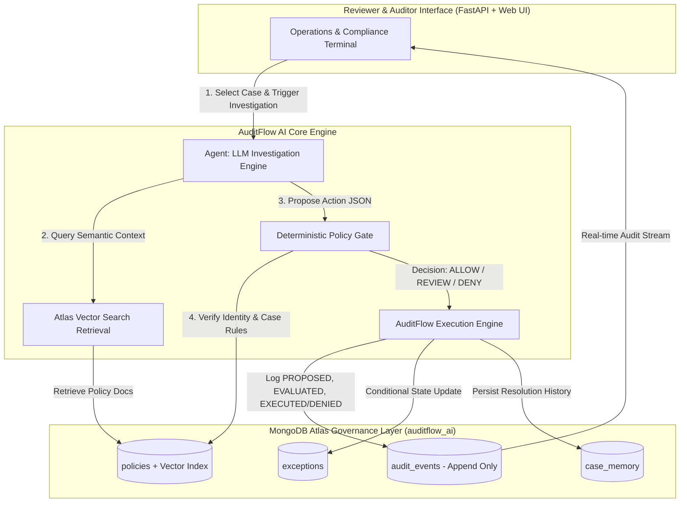

# AuditFlow AI: Implementation Plan & Team Build Guide

> **Project Name:** AuditFlow AI (`transactions_monitor`)  
> **Event:** Agents in Context Toronto: A MongoDB Hackathon (November 14, 2026)  
> **Problem Statement Alignment:** **Problem 1 – Agents You Can Audit**  
> **Core Promise:** *Every AI decision has an identity. Every action has a policy. Every outcome has an audit trail.*

---

## ⚠️ Critical Hackathon Rule Notice

> [!CAUTION]
> **Streamlit is Explicitly Banned Under Hackathon Rules**  
> Section *Strictly Banned Projects ("Anti-Projects")* in [`hackathon.md`](file:///Users/epheriami/Downloads/Projects/mongodb/hackathon.md#L55-L68) explicitly states:  
> `- ❌ Streamlit Applications`  
> `- ❌ Any project where a dashboard is the primary feature`  
> Submitting a Streamlit app risks **immediate disqualification**.  
> **Solution:** Build the backend with **FastAPI** (`backend/main.py`) and serve a clean **Tailwind + Vanilla JS or React single-page interface** (`frontend/`) styled as an **Operator & Compliance Auditor Terminal**. This keeps the agent and policy engine at the center, completely avoids Streamlit, and looks far more polished for the judges.

---

## 1. System Overview & The Three Demo Scenarios

AuditFlow AI investigates synthetic banking payment exceptions with an LLM, retrieves relevant policies from MongoDB Atlas via Vector Search, evaluates proposed actions against an independent deterministic policy gate, and records every decision in an immutable, append-only audit trail in Atlas.

The agent may **recommend** actions, but **cannot directly alter payment state without policy gate authorization**.

### Core Demo Scenarios Matrix

| Case ID | Exception Type | Amount | Evidence / Context | Expected Policy Decision | Required Outcome |
| :--- | :--- | :--- | :--- | :--- | :--- |
| **EX-1001** | `DUPLICATE_CHEQUE` | $850 CAD | Same account, same amount, matching cheque image hash, 2nd item unposted | **`ALLOW`** (`POL-001`) | Action: `CLOSE_DUPLICATE`<br>Status: `RESOLVED`<br>Logged to `case_memory` |
| **EX-1002** | `AMOUNT_MISMATCH` | $2,500 CAD | Source = $2,450, Processed = $2,500 (diff $50) | **`REVIEW`** (`POL-002`) | Action: `CORRECT_AMOUNT`<br>Status: `PENDING_APPROVAL`<br>Requires human reviewer sign-off |
| **EX-1003** | `SUSPICIOUS_TRANSFER` | $18,000 CAD | Risk flag active, new destination, compliance NOT cleared | **`DENY`** (`POL-003`) | Attempt: `RELEASE_TRANSFER`<br>Status: Unchanged (`OPEN`)<br>State untouched; audit logs denial |

---

## 2. Component Architecture



---

## 3. MongoDB Atlas Schema & Collections (`auditflow_ai`)

| Collection | Purpose | Schema / Key Fields |
| :--- | :--- | :--- |
| **`exceptions`** | Payment exception cases under investigation | `_id`, `type`, `amount`, `currency`, `status` (`OPEN`, `PENDING_APPROVAL`, `RESOLVED`, `ESCALATED`), `description`, `evidence` |
| **`policies`** | Policy text & embeddings for Vector Search | `_id` (`POL-001`, `POL-002`, `POL-003`), `text`, `version`, `embedding` (1536 dims) |
| **`audit_events`** | Chronological, append-only audit trail | `run_id`, `case_id`, `timestamp`, `event_type` (`PROPOSED`, `POLICY_EVALUATED`, `DENIED`, `REVIEW_REQUESTED`, `EXECUTED`, `EXECUTION_FAILED`), `actor`, `policy_version`, `detail` |
| **`case_memory`** | Persistent case resolution history for LLM context | `case_id`, `exception_type`, `action`, `outcome`, `policy_version`, `resolved_at` |
| **`transactions`** *(Optional)* | Underlying transaction ledger records | `_id`, `account_id`, `amount`, `timestamp`, `status` |

### Atlas Vector Search Index Definition
On database `auditflow_ai`, collection `policies`:
- **Index Name:** `policy_vector_index`
- **Definition JSON:**
```json
{
  "fields": [
    {
      "type": "vector",
      "path": "embedding",
      "numDimensions": 1536,
      "similarity": "cosine"
    }
  ]
}
```

---

## 4. Codebase Architecture & File Structure

```
transactions_monitor/
├── .env.example                     # Environment template
├── .gitignore                       # Ignored secrets (.env, .local, etc.)
├── README.md                        # Project landing doc
├── hackathon.md                     # Hackathon official rules
├── payment_exception_audit_agent.md # Detailed problem statement mapping
├── implementation_plan.md           # This document
├── requirements.txt                 # Python dependencies
├── database.py                      # MongoDB Atlas connection & collection handles
├── seed.py                          # Database seeder (3 demo exception cases)
├── agent.py                         # OpenAI structured investigation agent
├── policy_engine.py                 # Pure Python deterministic policy engine
├── executor.py                      # Safe state updater & audit event logger
├── vector_setup.py                  # Embeds policies into Atlas with vector index
├── retrieval.py                     # Vector Search policy aggregator
└── app.py / web/                    # Operator & Auditor UI (FastAPI + modern UI)
```

---

## 5. Implementation Roadmap (4-Hour Schedule)

| Elapsed Time | Milestone | Deliverable |
| :--- | :--- | :--- |
| **0:00 – 0:30** | **Atlas & Environment** | Working connection to MongoDB Atlas, seeded exceptions (`seed.py`) |
| **0:30 – 1:05** | **Investigation Agent** | Structured LLM recommendation in JSON (`agent.py`) |
| **1:05 – 1:45** | **Policy Engine** | Deterministic `ALLOW` / `REVIEW` / `DENY` enforcement (`policy_engine.py`) |
| **1:45 – 2:20** | **Audit & Memory** | State changes + append-only audit trail + case memory (`executor.py`) |
| **2:20 – 2:55** | **Auditor UI** | Fast, clean compliance & operator interface |
| **2:55 – 3:25** | **Atlas Vector Search** | Policy embedding and `$vectorSearch` retrieval (`vector_setup.py`, `retrieval.py`) |
| **3:25 – 3:45** | **Testing & Rehearsal** | Verify all 3 cases + negative tamper/denial test |
| **3:45 – 4:00** | **Buffer** | Polish, submission prep, and video recording |

---

## 6. Team Task Split

| Role | Owner | Tasks | Definition of Done |
| :--- | :--- | :--- | :--- |
| **Backend & Atlas** | Developer A | `database.py`, `seed.py`, `executor.py`, Atlas cluster config | 3 seeded cases load; denied actions NEVER modify database state |
| **AI & Retrieval** | Developer B | `agent.py`, `vector_setup.py`, `retrieval.py` | LLM returns valid JSON proposals; Vector Search retrieves top policy matches |
| **UI & Full Integration**| Developer C | Operator/Auditor UI, end-to-end integration | Interactive interface demonstrates all 3 exception workflows |
| **Presenter / Floater** | Presenter | Demo script rehearsal, slide/video capture, edge case testing | 3-minute pitch runs flawlessly without manual debugging |

---

## 7. Acceptance Test Criteria

1. **Atlas Connection:** `seed.py` connects and inserts exactly 3 demo cases (`EX-1001`, `EX-1002`, `EX-1003`).
2. **Case EX-1001 (Happy Path):** `CLOSE_DUPLICATE` recommendation with matching evidence returns `ALLOW` and updates case status to `RESOLVED`.
3. **Case EX-1001 (Negative Check):** Setting `same_cheque_image_hash=False` immediately causes `CLOSE_DUPLICATE` to return `DENY`.
4. **Case EX-1002 (Human Oversight):** `CORRECT_AMOUNT` returns `REVIEW`; case status moves to `PENDING_APPROVAL`; payment amount remains unchanged.
5. **Case EX-1003 (Enforced Denial):** Deliberately attempting `RELEASE_TRANSFER` returns `DENY`; case status remains `OPEN`; state is untouched.
6. **Audit Completeness:** Every run creates chronological `PROPOSED` and `POLICY_EVALUATED` entries with `run_id` and `actor`. A denial generates a `DENIED` event and **no `EXECUTED` event**.
7. **Atlas Vector Search:** `retrieve_policies()` retrieves relevant policy IDs and cosine similarity scores.
8. **Persistence:** Restarting the server preserves all case resolutions, audit history, and memory in Atlas.

---

## 8. Competition 3-Minute Demo Script

| Time | Segment | What to Show & Narrative |
| :--- | :--- | :--- |
| **0:00 – 0:30** | **The Hook & Problem** | Open the Exception Queue. *"Banks process thousands of exceptions daily. Unchecked AI is a catastrophic regulatory risk. Enter AuditFlow AI: policy-governed automation."* |
| **0:30 – 1:00** | **Architecture** | Show the policy gate. *"The LLM can investigate and propose, but has ZERO write authority. Every action must clear a deterministic gate in Atlas."* |
| **1:00 – 1:35** | **EX-1001 (Allow)** | Show duplicate cheque. Run AI investigation. Policy gate verifies image hash & unposted duplicate -> **`ALLOW`**. Case marks `RESOLVED`. |
| **1:35 – 1:55** | **EX-1002 (Review)** | Amount mismatch ($2,450 vs $2,500). Agent proposes correction. Policy enforces human sign-off -> **`REVIEW`**. Moves to approvals queue. |
| **1:55 – 2:25** | **EX-1003 (Deny - The Judge Moment)** | High-value suspicious transfer ($18K) with compliance flag. Propose release -> **Instant hard `DENY`**. Case remains locked in place. |
| **2:25 – 2:45** | **Audit Trail & Vector Search** | Show full timeline in Atlas: run IDs, actor identity, policy IDs, and vector search matches. |
| **2:45 – 3:00** | **Closing** | *"MongoDB Atlas is the identity, policy, memory, and audit layer that turns experimental AI into bankable, production-ready software."* |
