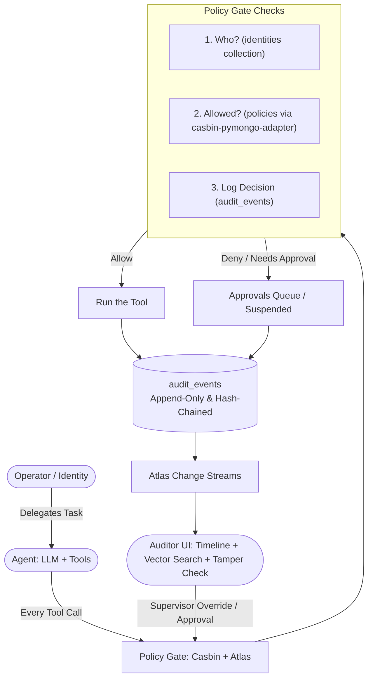

# Project Case: Auditable Payment Exception Resolution Agent

> **Problem Statement Alignment:** **Problem 1 – Agents You Can Audit**  
> *"Build an agent using MongoDB Atlas as the identity, policy and audit layer that takes real actions across systems, where every action is tied to an identity, checked against policy before it runs, and recorded so a reviewer can reconstruct it afterward."*

---

## 1. Executive Summary & Business Idea

Financial operations teams handle high volumes of payment exceptions (e.g., sanctioned accounts, mismatched routing numbers, suspicious velocity, or over-limit transfers). 

This project implements an **autonomous AI operations agent that investigates and resolves payment exceptions**. Rather than granting unconstrained execution permissions, **every single tool call is intercepted by a MongoDB Atlas governance layer** that enforces:
1. **Identity & Delegation:** The agent acts explicitly on behalf of an authenticated human operator with defined roles and delegations (`Agent X` acts for `User Y`).
2. **Pre-Execution Policy Gates:** Deterministic policies evaluated *before* execution (e.g., *"Agents may hold payments under \$10K but not release them"*, *"Releases over \$50K require two approvers"*, *"No access to PII fields for VIP accounts"*).
3. **Immutable, Tamper-Evident Audit:** An append-only ledger capturing intent, policy decisions, tool inputs/outputs, reasoning, and cryptographic hash chains.

---

## 2. Policy Engine Evaluation & Architecture

Banks handle thousands of payment exceptions every day, such as returned cheques, duplicate items, amount mismatches, and suspicious transfers. AI agents could resolve many of these, but banks cannot deploy an agent unless every action is tied to an identity and approved by policy before execution.

The hackathon rules specify that **MongoDB Atlas must serve as the identity, policy, and audit layer**. Therefore, policies are stored directly in Atlas, using an open-source policy engine strictly to evaluate them in-memory. This keeps MongoDB at the center of the architecture.

### Open-Source Policy Engine Options

| Engine | Policy Language | Works with MongoDB? | Fit for a One-Day Build |
| :--- | :--- | :--- | :--- |
| **Casbin ⭐** | RBAC / ABAC model + policy rules | **Yes, native adapter (`casbin-pymongo-adapter`)** stores policies directly in Atlas | ⭐⭐⭐ **Easiest; policies live in Atlas** |
| **Open Policy Agent (OPA)** | Rego | Indirect: load policy data from Atlas into OPA | ⭐⭐ Industry standard, but Rego takes time to learn |
| **Cerbos** | YAML | Indirect: store YAML in Atlas and sync it | ⭐⭐ Readable, but runs as a separate server |
| **Cedar (AWS)** | Cedar | Store policy text in Atlas, evaluate with `cedarpy` | ⭐⭐ Elegant, but newer |
| **OpenFGA** | Relationship-based (Zanzibar) | Separate store | ⭐ Overkill for this hackathon |

> [!TIP]
> **Recommendation:** **Casbin with the MongoDB adapter (`casbin-pymongo-adapter`)**.  
> Policies sit directly in an Atlas collection, supporting roles, attributes, and monetary amount limits. It can be implemented and working in under an hour.

---

### End-to-End System Architecture



---

## 3. MongoDB Collections Design & Key Fields

| Collection | Purpose | Key Fields |
| :--- | :--- | :--- |
| `identities` | Agents, operators, roles, and delegations | `id`, `type` (`human` \| `agent`), `role`, `on_behalf_of`, `limits` |
| `policies` | Casbin policy rules stored natively via `casbin-pymongo-adapter` | `ptype` (p/g), `v0` (sub/role), `v1` (obj/resource), `v2` (act/action), `v3` (eft/condition), `v4` (extra rules) |
| `payments` | Operational payment records and exception states | `payment_id`, `amount`, `currency`, `sender`, `beneficiary`, `status` (`FLAGGED_EXCEPTION`, `HELD`, `RELEASED`), `risk_tier` |
| `audit_events` | Append-only ledger with cryptographic hash chaining | `event_id`, `timestamp`, `trace_id`, `identity_id`, `action`, `tool_name`, `input_args`, `policy_decision`, `reasoning`, `prev_hash`, `hash` |

---

## 4. Key Atlas Features Utilized

1. **Atlas Change Streams:**
   - Powers real-time streaming to the compliance / second-approver interface.
   - Triggers alerts immediately when high-risk policy violations or multi-approver requirements arise.
2. **Schema Validation & Access Controls (RBAC):**
   - Collection-level `$jsonSchema` prevents unauthorized modification or deletion of `audit_events`.
   - The application database user has strictly `insert`-only privileges on `audit_events`.
3. **Cryptographic Hash Chaining (Tamper Evidence):**
   - Each audit document computes `hash = SHA256(prev_hash + timestamp + action + input + decision + output)`.
   - Modifying any historical audit entry breaks the cryptographic chain immediately during audit verification.
4. **Atlas Vector Search (Auditor Querying):**
   - Embeds audit reasoning and exception context.
   - Allows compliance reviewers to query in plain English: *"Show every instance where the agent held a payment exceeding \$20,000 due to velocity flags."*
5. **Atlas Charts / Reviewer Timeline:**
   - Provides visualization for compliance teams to review agent decisions and identify policy bottleneck patterns.

---

## 5. Agent Tools & Pre-Execution Policy Logic

The agent is equipped with standard operational tools, but **cannot invoke them directly without the Atlas policy interceptor**:

```python
# Interceptor Pattern Example with Casbin & Atlas
import casbin
from casbin_pymongo_adapter import Adapter

def get_enforcer():
    adapter = Adapter("mongodb+srv://...", "transactions_monitor")
    # Loads model and policies dynamically from Atlas
    return casbin.Enforcer("rbac_with_domains_model.conf", adapter)

def execute_agent_tool(tool_name: str, args: dict, operator_identity: str):
    # 1. Resolve Identity and Delegated Permissions from Atlas
    identity = db.identities.find_one({"id": operator_identity})
    
    # 2. Evaluate Policy via Casbin Enforcer
    enforcer = get_enforcer()
    sub = identity.get("role")
    obj = tool_name
    act = args.get("action_type", "execute")
    
    if not enforcer.enforce(sub, obj, act):
        log_audit_event(status="BLOCKED", identity=identity, tool=tool_name, args=args)
        return {"error": f"Policy Violation: {sub} is not authorized for {obj}:{act}"}
        
    # Check conditional limits (e.g. monetary threshold)
    amount = args.get("amount", 0)
    if amount > identity.get("limits", {}).get("max_auto_release", 10000):
        log_audit_event(status="AWAITING_APPROVAL", identity=identity, tool=tool_name, args=args)
        return {"status": "HOLD", "message": f"Amount ${amount} exceeds limit. Sent to approvals queue."}
        
    # 3. Execute Tool
    result = tools[tool_name](**args)
    
    # 4. Record Hash-Chained Audit Record
    log_audit_event(status="EXECUTED", identity=identity, tool=tool_name, args=args, result=result)
    return result
```

### Tools Defined:
* `get_payment_exception(payment_id)`
* `hold_payment(payment_id, reason)`
* `release_payment(payment_id, destination)`
* `request_supervisor_approval(payment_id, justification)`

---

## 6. Live Demo Flow (5-Minute Script)

1. **Step 1: Task Delegation & Investigation (Allowed)**
   - *Action:* Operator prompts: *"Investigate exception #PAY-10492 and resolve it."*
   - *Behavior:* Agent inspects payment via `get_payment_exception`. Policy checks operator clearance: **ALLOWED**. Audit log records investigation intent.
2. **Step 2: Policy Interception & Hard Block (Pre-Execution Gate)**
   - *Action:* Agent determines payment is valid and attempts `release_payment($75,000)`.
   - *Behavior:* The Atlas Policy Interceptor catches the action. Rule states: *"Releases > \$50,000 require dual-approver sign-off."*
   - *Result:* Action **BLOCKED/HELD**. Atlas stores the reason and pushes a Change Stream event to the dashboard.
3. **Step 3: Human-in-the-Loop Sign-off & Completion**
   - *Action:* Second authorized supervisor reviews the reasoning and signs off via UI.
   - *Behavior:* The agent resumes the workflow, the transaction completes, and both authorizations are permanently logged.
4. **Step 4: Tamper-Evident Audit Verification & Vector Search**
   - *Action:* The auditor view calculates the SHA-256 hash chain of the entire audit trail.
   - *Demo:* A direct database mutation is simulated (e.g., someone attempts to modify the dollar amount in the audit collection). The verification tool flags **"TAMPER DETECTED: Hash mismatch at Block #14"**.
   - *Query:* Auditor asks via Vector Search: *"Find all high-value overrides signed off this morning."*

---

## 7. Implementation Stack & Rules Compliance

### Recommended Tech Stack:
* **Backend:** Python (FastAPI / LangGraph / LangChain tool calling) or Node.js (TypeScript).
* **Database:** MongoDB Atlas (M0/M10 Sandbox cluster with Change Streams, Vector Index, Schema Validation).
* **Frontend:** React + Tailwind or lightweight HTML/SSE (Server-Sent Events) live timeline.

> [!WARNING]
> **Hackathon Rule Warning on Streamlit & Dashboards:**  
> The hackathon guidelines explicitly list **"Streamlit Applications"** and **"Any project where a dashboard is the main feature"** under the **STRICTLY BANNED Anti-Projects**.  
> Ensure your UI is framed strictly as an **Interactive Compliance Reviewer & Approval Terminal**, with the primary focus placed on the **MongoDB Policy Interception Engine & Tool-Calling Agent**.
