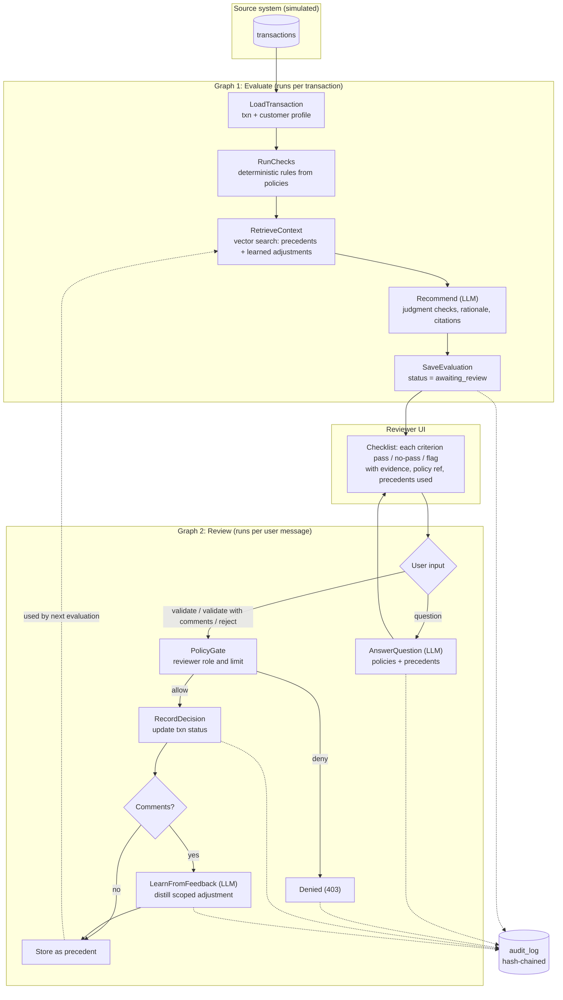

# Transaction Validation Agent — Design & Regulatory Context

Background architecture and Canadian regulatory context for the **Agents in Context Toronto** (Track 1: *Agents You Can Audit*) project.  
For exact collection shapes, enums, HTTP endpoints, and Python interfaces, see [`docs/contracts.md`](docs/contracts.md).

One-line pitch: *"The agent runs the checklist and learns from every reviewer decision. Atlas records who taught it what, and which rule let them."*

| Track Requirement | How It Is Met |
| --- | --- |
| Every action tied to an identity | Every audit event carries `actor` (agent `on_behalf_of` a named analyst, or the human) |
| Checked against policy before it runs | Deterministic gate checks the reviewer's role and limit before a decision or memory is recorded |
| Recorded so a reviewer can reconstruct it | Hash-chained `audit_log`; each evaluation stores the policy versions, precedents, and adjustments it used |

---

## 1. Workflow

Two short LangGraph graphs with all state stored in MongoDB between HTTP calls (no checkpointer or `interrupt()`):

### Guardrails for Auditable Learning

1. **Hard checks are deterministic code, not LLM.** A sanctions hit or missing mandatory field is `no_pass` regardless of what the model or memory says.
2. **Memory cannot override a hard check.** Adjustments only apply to criteria marked `judgment` in the policy.
3. **Every adjustment has an author.** Links to the `source_decision_id`, reviewer identity, and policy rule that allowed the write.
4. **Every evaluation lists the adjustments it used.** Auditors can trace why an evaluation passed to a named person and date.
5. **Adjustments are revocable.** Soft-deactivated (`active: false`), never deleted.
6. **Prompt injection resilience.** Untrusted fields (`memo`, `counterparty`) cannot bypass deterministic `hard` checks.

---

## 2. Checklists by Transaction Type

Kind: **H** = hard (deterministic, cannot be overridden by memory), **J** = judgment (LLM, can be adjusted by memory). Demo scope: `wire` and `cheque`.

| ID | Applies to | Criterion | Kind | Basis |
| --- | --- | --- | --- | --- |
| C-01 | All | Counterparty not on a sanctions list | H | Canadian sanctions law (SEMA and related lists) |
| C-02 | All | Account open, sufficient funds | H | Bank policy |
| C-03 | All | Not a duplicate (same payee, amount, date) | H | Bank policy |
| C-04 | All | Amount consistent with the customer's usual profile | J | FINTRAC suspicious-transaction indicators |
| C-05 | All | No structuring: transactions in 24 h that total \$10,000 or more | H | FINTRAC 24-hour rule |
| W-01 | Wire | Originator and beneficiary name, address, account number present | H | FINTRAC travel rule |
| W-02 | Wire | International transfer of \$10,000 or more flagged for EFT report | H | FINTRAC EFT reporting |
| W-03 | Wire | New beneficiary or high-risk destination explained | J | FINTRAC suspicious-transaction indicators |
| Q-01 | Cheque | Not stale-dated (over 6 months) or post-dated | H | Bank practice |
| Q-02 | Cheque | Hold period applied for the amount | H | Access to Funds Regulations |

---

## 3. Regulatory Background

| Topic | Summary | Relevance |
| --- | --- | --- |
| **FINTRAC EFT reporting** | International electronic funds transfers of \$10,000+ CAD must be reported (single or 24-hour aggregated). Records kept ≥ 5 years. | Real threshold and 24-hour aggregation check (`W-02`, `C-05`). |
| **FINTRAC travel rule** | Originator and beneficiary name, address, and account/reference number must accompany a transfer. | Deterministic missing-information check (`W-01`). |
| **Access to Funds Regulations (SOR/2012-24)** | Limits how long a bank may hold cheque funds based on amount and deposit channel. | Basis for cheque hold check (`Q-02`). |
| **OSFI Guideline E-23 (Model Risk)** | Final version published Sept 11, 2025, effective **May 1, 2027** for federally regulated financial institutions; scope explicitly includes AI/ML models. | Regulatory urgency: banks must govern AI models, including ones that learn. |

> **Note:** Thresholds and rules in this demo are illustrative, not compliance advice.

---

## 4. Sources

- FINTRAC, Reporting electronic funds transfers: https://fintrac-canafe.canada.ca/guidance-directives/transaction-operation/eft-dt/eft-dt-eng
- FINTRAC, The 24-hour rule: https://fintrac-canafe.canada.ca/guidance-directives/transaction-operation/24hour/1-eng
- Travel rule summary: https://substancelaw.ca/travel-rule/
- Access to Funds Regulations (SOR/2012-24): https://laws.justice.gc.ca/eng/regulations/SOR-2012-24/FullText.html
- OSFI Guideline E-23 Model Risk Management (2027): https://www.osfi-bsif.gc.ca/en/guidance/guidance-library/guideline-e-23-model-risk-management-2027-letter
- Torys on E-23 AI scope: https://www.torys.com/our-latest-thinking/publications/2025/10/osfi-updates-and-expands-scope-of-guideline-e-23
